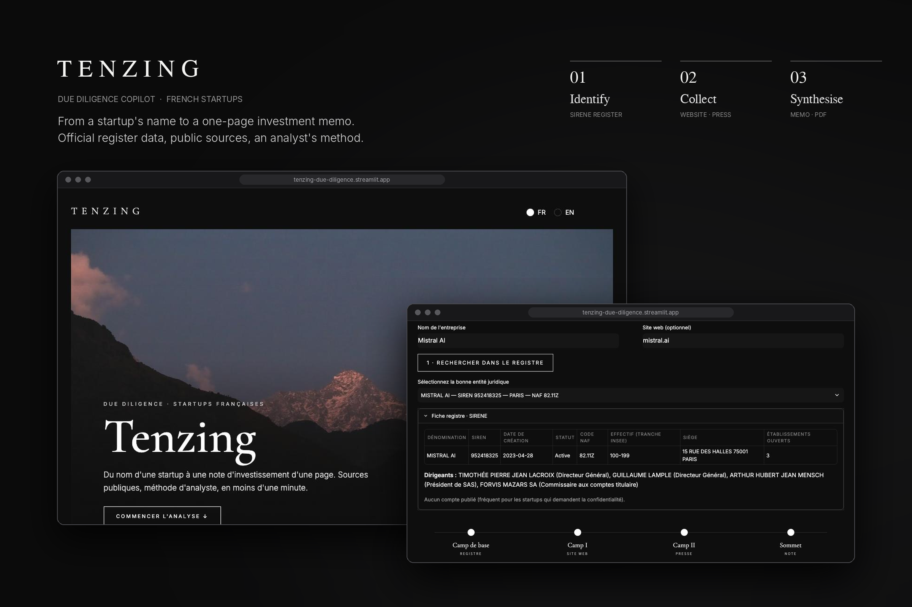

# 🏔️ Tenzing

**Your due diligence sherpa: from a French startup's name to a one-page investment memo in under a minute, using public sources only.**

*Named after Tenzing Norgay, the Sherpa who reached the summit of Everest with Edmund Hillary in 1953. Before any ascent, someone has to scout the route.*

[▶️ Live demo](https://tenzing-due-diligence.streamlit.app/#analysis) · Built with Python, Streamlit and open-weight LLMs



---

## The problem

Early-stage screening is time-consuming. Before a first call with a founding team, an analyst or consultant typically spends 1–2 hours gathering basic facts: legal entity, founding date, headcount, published accounts, recent news, and then turning them into a structured view of strengths, risks and open questions.

## The solution

Tenzing automates this first pass:

1. **Identifies the legal entity** in the official French company register (SIRENE).
2. **Collects public signals**: registry data, published financials, executives, company website, recent press coverage.
3. **Drafts a one-page memo**: summary, business model, traction signals, strengths, risks, and **8–10 prioritised questions for management**.

Each statement is tagged with its source (`[S1]`, `[S2]`, `[S3]`), and hypotheses are explicitly separated from facts.

## Example output

See [`examples/`](examples/) for sample memos.

## Data sources

| Source | Content | Access |
|---|---|---|
| [API Recherche d'entreprises](https://recherche-entreprises.api.gouv.fr) (data.gouv.fr) | SIREN, legal data, executives, headcount bracket, published financials | Free, no key |
| Company website | Positioning, offer, messaging | Public |
| Google News RSS | Recent headlines | Public |
| Groq (default), Mistral AI or Claude (Anthropic) | Analysis and drafting | API key (free plans on Groq and Mistral) |

## Design choices

- **Facts vs. hypotheses**: the model is instructed never to invent figures and to flag every assumption.
- **"Blind spots" section**: every memo states what the available data *cannot* tell you.
- **Engine-agnostic**: the analysis engine can be switched (Groq, Mistral AI, Claude) without changing the method, with automatic fallback between models.
- **Human in the loop**: the user validates the legal entity before analysis, avoiding homonym errors.

## Limitations

- Startups often keep their accounts confidential: financial data may be missing.
- Press analysis is based on headlines only, not full articles.
- This is a screening aid, **not investment advice**, and does not replace a full due diligence.

## Roadmap

- [ ] INPI / RNE integration (filings, capital increases, bylaws)
- [ ] Funding rounds history
- [ ] PDF export in a consulting-style template
- [ ] Peer comparison within the same NAF code

## Run locally

```bash
pip install -r requirements.txt
streamlit run app.py
```

## Credits

Mountain photographs © Nicolas Leonard de Juvigny.

## Author

**Nicolas Juvigny** — Strategy consultant, INSEAD · CELSA
[LinkedIn](https://linkedin.com/in/nicolasjuvigny)
